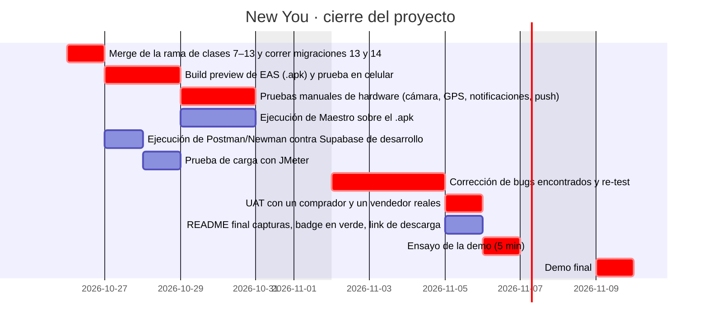

# Cronograma PERT / Gantt — cierre del proyecto

Planificación del tramo final (clase 12 de Testing y Calidad: PMBOK, PERT y Gantt; criterios E3 y E4
de la checklist). Las actividades de testing están dentro del cronograma y no al final.

Duraciones en días hábiles. Estimación PERT: **TE = (O + 4M + P) / 6**, desviación **σ = (P − O) / 6**.
Inicio previsto: lunes 26/10/2026 (ajustar a la fecha real de la demo de la cátedra).

| Id | Actividad | Depende de (FS) | O | M | P | TE | σ | Inicio temprano | Fin temprano | Holgura |
| --- | --- | --- | --- | --- | --- | --- | --- | --- | --- | --- |
| A | Merge de la rama de clases 7–13 y correr migraciones 13 y 14 | — | 0.5 | 1 | 2 | 1.08 | 0.25 | 0.00 | 1.08 | 0.00 |
| B | Build preview de EAS (.apk) y prueba en celular | A | 1 | 2 | 4 | 2.17 | 0.50 | 1.08 | 3.25 | 0.00 |
| C | Pruebas manuales de hardware (cámara, GPS, notificaciones, push) | B | 1 | 2 | 3 | 2.00 | 0.33 | 3.25 | 5.25 | 0.00 |
| D | Ejecución de Maestro sobre el .apk | B | 1 | 1.5 | 3 | 1.67 | 0.33 | 3.25 | 4.92 | 0.33 |
| E | Ejecución de Postman/Newman contra Supabase de desarrollo | A | 0.5 | 1 | 2 | 1.08 | 0.25 | 1.08 | 2.17 | 2.00 |
| F | Prueba de carga con JMeter | E | 0.5 | 1 | 2 | 1.08 | 0.25 | 2.17 | 3.25 | 2.00 |
| G | Corrección de bugs encontrados y re-test | C, D, F | 1 | 3 | 6 | 3.17 | 0.83 | 5.25 | 8.42 | 0.00 |
| H | UAT con un comprador y un vendedor reales | G | 1 | 1 | 2 | 1.17 | 0.17 | 8.42 | 9.58 | 0.00 |
| I | README final: capturas, badge en verde, link de descarga | G | 0.5 | 1 | 1.5 | 1.00 | 0.17 | 8.42 | 9.42 | 0.17 |
| J | Ensayo de la demo (5 min) | H, I | 0.5 | 1 | 1 | 0.92 | 0.08 | 9.58 | 10.50 | 0.00 |
| K | Demo final | J | 0.5 | 0.5 | 0.5 | 0.50 | 0.00 | 10.50 | 11.00 | 0.00 |

**Camino crítico:** A → B → C → G → H → J → K · duración esperada **11.0 días hábiles**.
Varianza del camino crítico: 1.15 (σ = 1.07); con 90 % de confianza el cierre
lleva como mucho **12.4 días hábiles** (TE + 1,28 σ).

Hitos: **H1** build de preview instalado (fin de B) · **H2** testing completo (fin de G) · **H3** demo final (K).

Todas las dependencias son fin-a-comienzo (FS). La E (Postman) puede arrancar en paralelo con el
build porque sólo necesita la base migrada, y la F tiene holgura: si se atrasa, no mueve la demo.

La EDT con el paquete de testing está en la carpeta del proyecto (`edt/EDT-NewYou.docx`).
